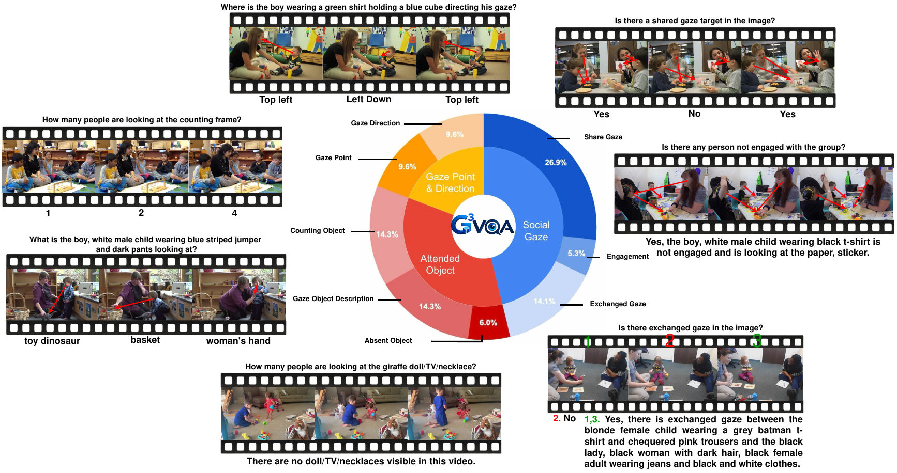

  

<h1 align="center">Attention in Motion: G3VQA for Social Gaze Understanding in Video</h1>

  <a href="https://shayan137.github.io/GazeVQA/">Project page</a> ·
  Paper (coming soon) ·
  Data (coming soon)

**G3VQA** (Group Glance Gaze VQA) is a video benchmark for social and temporal gaze reasoning. It asks a vision language model who is looking, what they look at, how attention is shared between people, and how all of this changes over a clip.

* 381 video clips from [ChildPlay](https://www.idiap.ch/en/scientific-research/data/childplay-gaze), with around 7K manually annotated key frames
* around 900K frame level question answer pairs in nine question types
* around 30K temporal questions in 21 templates that ask when, how often and in what order people look at objects and at each other, also while a face is hidden
* every gaze, appearance and social attention label was made and checked by human annotators, and no language model wrote a question or an answer
* a training free gaze tracking agent that gives the VLMs their gaze evidence and needs 83% less inference time than running the gaze estimator on every frame

We tested 15 VLMs. The best one answers 41% of the questions correctly, and accuracy drops from 32% on frame level questions to 21% on temporal ones. The [project page](https://shayan137.github.io/GazeVQA/) has ten test videos with the gaze annotations and temporal questions drawn on them, and the numbers are in the paper.

