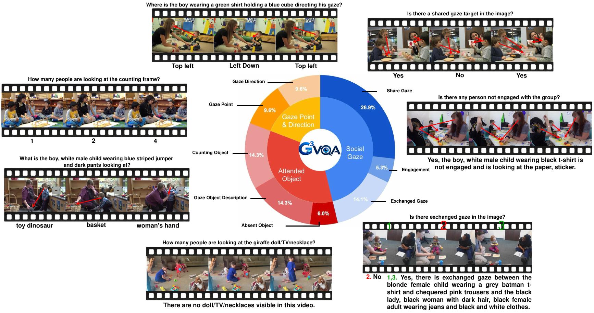

<h1 align="center">W<sup>3</sup>Gaze VQA: Do Vision Large Language Models Know<br/>Who Looks at What, and When?</h1>

<p align="center">
  <a href="https://shayan137.github.io/GazeVQA/"></a>
</p>

**W<sup>3</sup>Gaze VQA** is a manually annotated video benchmark for social and temporal gaze reasoning. It asks a vision large language model (VLLM) who is looking, what they look at, how attention is shared between people, and how this changes over a clip.

<p align="center">
  
</p>

## Key Points

* **Benchmark:** 381 clips from [ChildPlay](https://www.idiap.ch/en/scientific-research/data/childplay-gaze), with around 640K frame level questions in nine types and around 15K temporal questions in 21 types.
* **Manual labels:** People wrote and checked every gaze, appearance and social attention label.
* **Gaze tracking agent:** A training free agent gives the VLLMs their gaze arrows with 85% fewer gaze estimator calls than running the estimator on every frame.
* **Results:** Across 16 VLLMs the best model answers 41% of the questions, and the average accuracy falls from 32% on frame level questions to 21% on temporal questions.

## Installation

```bash
git clone https://github.com/shayan137/GazeVQA.git
cd GazeVQA
pip install -r requirements.txt
```

The VLLMs and the judge are served with [vLLM](https://github.com/vllm-project/vllm). The tracking agent also needs a clone of [OpenFace 3.0](https://github.com/CMU-MultiComp-Lab/OpenFace-3.0) with its multitask checkpoint.

## Data Preparation

1. Download the [ChildPlay](https://www.idiap.ch/en/scientific-research/data/childplay-gaze) videos and its `clips.csv`.
2. Put the W<sup>3</sup>Gaze VQA annotation files of the test split into `data/annotations/test`. Every clip has `<clip>.csv` (head boxes and gaze labels), `<clip>_VQA.csv` (frame level questions) and `<clip>_temporal.csv` (temporal questions).
3. Set the paths in `configs/w3gaze.yaml` and extract the frames:

```bash
python scripts/extract_frames.py
```

## Configuration

Every path and hyperparameter is in one file, `configs/w3gaze.yaml`. It has one block for each step: `tracking`, `visual_prompt`, `vqa`, `judge` and `grounding`. All scripts read this file, and `--config` selects another one.

## Usage

### 1. Gaze tracking agent

```bash
python scripts/run_tracking.py
python scripts/run_tracking.py --dense --output-csv outputs/tracking/page_dense.csv
python scripts/eval_tracking.py outputs/tracking/page.csv outputs/tracking/page_dense.csv
```

The first command runs the agent, the second runs the estimator on every frame, and the third prints the number of estimator calls, AUC, average L2 and in or out AP of both.

`tracking.estimator` selects the gaze estimator. Gaze-LLE and GazeAnywhere run directly. PaGE and the other estimators need their own Python environment, so they first write their predictions to a cache file, and `estimator: cached` replays it:

```bash
python scripts/export_frame_list.py
python benchmarks/gaze_estimators/page/export_dense.py \
  --frame-list outputs/gaze_benchmark/frame_list.csv \
  --out outputs/gaze_benchmark/caches/page.npz
```

### 2. VLLM evaluation

```bash
# draw the gaze arrows on the frames and videos
python scripts/render_inputs.py

# serve a VLLM and ask it every question
vllm serve Qwen/Qwen3.5-27B --served-model-name qwen3.5-27b --port 8000 --max-model-len 32768 \
  --limit-mm-per-prompt '{"image": 1, "video": 1}' --media-io-kwargs '{"video": {"num_frames": -1}}'
python scripts/run_vqa.py --answer-model qwen3.5-27b
```

```text
Gaze Tracking Agent
→ Gaze Arrows on the Frame or Video
→ VLLM Answer
→ Exact Match or Judge
```

### 3. Scoring

Answers with a yes or no, a count or a frame number are scored by exact match. All other answers are scored by the [AnyJev](https://github.com/nokia-applied-research/AnyJev) judge.

```bash
vllm serve morriszjm/Tacit-9B --port 8100 --max-model-len 16384 --limit-mm-per-prompt '{"image": 0, "video": 0}'
python scripts/judge_answers.py
python scripts/score_vqa.py
```

### 4. Gaze target grounding

```bash
python benchmarks/grounding/run_detect.py
python benchmarks/grounding/select_gaze_target.py
python benchmarks/grounding/eval_grounding.py
```

`grounding.detector` selects RF-DETR, YOLO26 or WeDetect.

## Code Structure

```
configs/
  w3gaze.yaml               # all paths and hyperparameters
source/
  config.py                 # loads the YAML file
  data/                     # label and question files
  tracking/                 # agent, triggers, OpenFace, point tracker, estimators, metrics
  vqa/                      # prompts, gaze arrows, videos, vLLM client, runner, exact match
scripts/
  extract_frames.py         # ChildPlay videos to frames
  run_tracking.py           # gaze tracking agent
  eval_tracking.py          # tracking metrics
  render_inputs.py          # frames and videos with gaze arrows
  run_vqa.py                # ask a VLLM every question
  judge_answers.py          # AnyJev judge
  score_vqa.py              # accuracy per question group
benchmarks/
  gaze_estimators/          # PaGE, Gaze-LLE, GazeAnywhere, Sharingan, Gupta et al.
  grounding/                # detectors and gaze target selection
docs/                       # project page
```

## Citation

```bibtex
@article{w3gazevqa2027,
  title = {W$^3$Gaze VQA: Do Vision Large Language Models Know Who Looks at What, and When?},
  year  = {2027}
}
```
