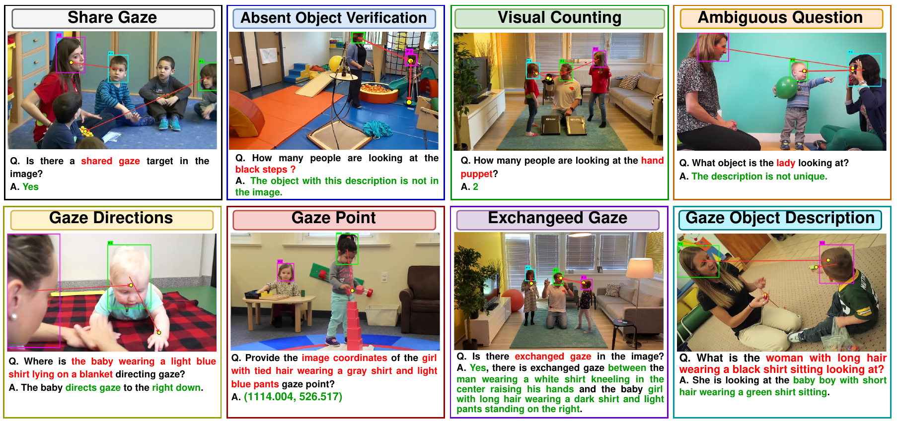
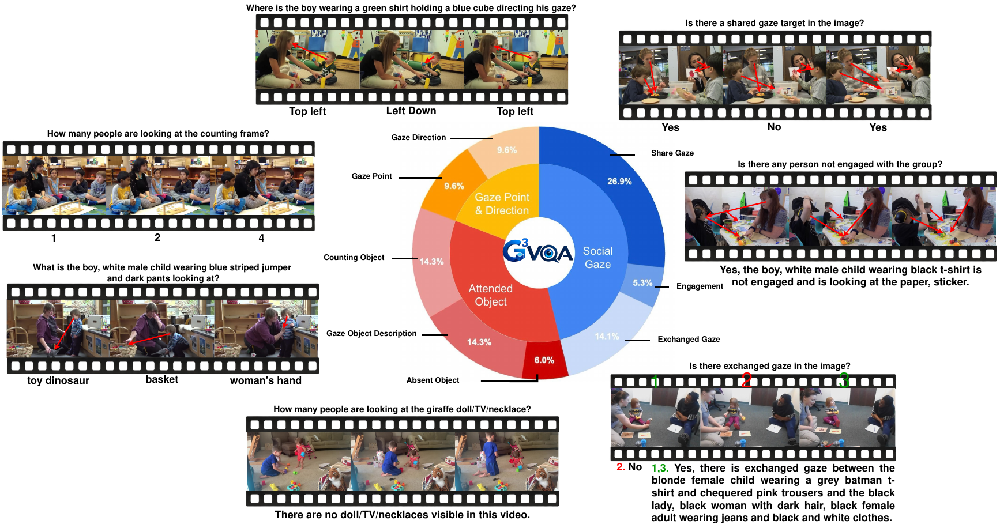
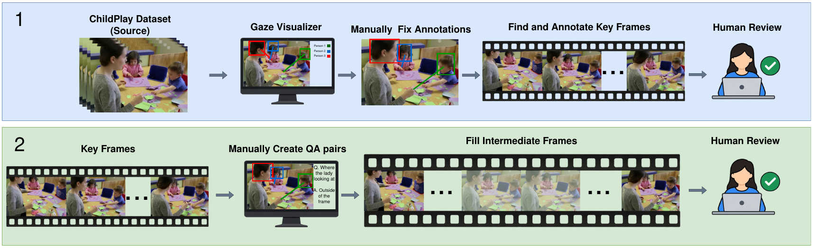

<h1 align="center">Attention in Motion: G<sup>3</sup>VQA for<br/>Social Gaze Understanding in Video</h1>

**G<sup>3</sup>VQA** (Group Glance Gaze VQA) is a manually annotated video gaze VQA benchmark for temporal and social gaze reasoning. It contains **381 video clips**, **6,517 annotated key frames** and **601,350 question-answer pairs** across **nine question types**, covering who is looking, what they look at, and how attention is shared between people over time.
All gaze, appearance and social attention labels are made and checked by human annotators. No LLM or VLM is used to write the questions or answers.

<p align="center">
  
</p>

## Benchmark

The questions are grouped into three categories and nine types:

* **Gaze point & direction:** gaze point, gaze direction
* **Attended object:** gaze object description, counting, absent object, ambiguous description
* **Social gaze:** shared gaze, exchanged gaze, group engagement

<p align="center">
  
</p>

The benchmark is built on [ChildPlay](https://www.idiap.ch/en/scientific-research/data/childplay-gaze). Annotators first corrected the gaze and head box labels of 50 ChildPlay videos and selected key frames. They then wrote the QA pairs for each key frame, which are propagated to the frames in between and reviewed again.

<p align="center">
  
</p>

## Evaluation

Evaluation runs in two stages:

1. **Gaze tracking.** A training-free agent predicts where every person looks in every frame. The image gaze estimator ([Gaze-LLE](https://github.com/fkryan/gazelle) or [GazeAnywhere](https://github.com/IrohXu/GazeAnywhere)) runs only when [OpenFace 3.0](https://github.com/CMU-MultiComp-Lab/OpenFace-3.0) detects a head/eye movement (or when the tracked point drifts). Between those frames, the gaze point is followed with Lucas-Kanade optical flow. This cuts gaze estimator calls from 4,440 to 714 (about 83% less inference time).
2. **VQA.** The predicted gaze is drawn as a blue arrow from each person's head to their gaze target, and the frame and question are given to the VLM. Answers are scored by a text-only judge (Qwen3.8-27B, 0-5), which sees the question and the reference answer but not the image. We also report embedding similarity, BLEU-4, ROUGE-L and token F1.

Gaze point and gaze direction questions are answered directly from the tracked gaze. The other six question types are answered by the VLM.

## Results

**Gaze tracking** (21 person tracks, 4,440 person-frames)

| Method | Calls ↓ | AUC ↑ | Avg. L2 ↓ | Inout AP ↑ |
|---|---|---|---|---|
| Gaze-LLE (dense) | 4,440 | 0.9383 | 0.1300 | 0.9750 |
| Gaze-LLE + ours | 714 | 0.9371 | 0.1307 | 0.9805 |
| GazeAnywhere (dense) | 4,440 | 0.9234 | 0.1539 | 0.9215 |
| GazeAnywhere + ours | 713 | 0.9323 | 0.1494 | 0.9265 |

**VLMs on G<sup>3</sup>VQA** (Gaze-LLE predictions, Qwen3.8-27B judge)

| Model | Judge ↑ | ≥4 (%) ↑ | Embed. ↑ |
|---|---|---|---|
| Molmo2-O-7B | 1.455 | 23.1 | 0.470 |
| Qwen3.5-0.8B | 1.451 | 24.3 | 0.443 |
| Qwen3.5-2B | 1.907 | 31.5 | 0.481 |
| InternVL3.5-2B | 1.594 | 22.5 | 0.475 |
| InternVL3.5-4B | 1.806 | 28.1 | 0.475 |
| Molmo2-4B | 1.506 | 24.8 | 0.489 |
| Molmo2-8B | 1.603 | 27.2 | 0.495 |
| InternVL3.5-8B | 1.579 | 22.7 | 0.480 |
| InternVL3.5-14B | 1.804 | 26.4 | 0.477 |
| InternVL3.5-GPT-OSS-20B-A4B | 1.536 | 21.7 | 0.469 |
| Qwen3.5-27B | 2.068 | 34.8 | 0.441 |
| InternVL3.5-30B-A3B | 1.729 | 26.2 | 0.482 |
| Qwen3.6-35B-A3B | 2.047 | 34.3 | 0.426 |
| Qwen3.5-35B-A3B | 2.027 | 35.0 | 0.446 |
| InternVL3.5-38B | 1.975 | 30.6 | 0.483 |
| Qwen3.5-122B-A10B | **2.103** | **35.9** | 0.420 |

## Installation

```bash
git clone https://github.com/shayan137/G3VQA.git
cd G3VQA
pip install -r requirements.txt
```

Gaze-LLE, GazeAnywhere and the embedding model are downloaded automatically into `model_cache_dir` on first use. You also need:

* [OpenFace 3.0](https://github.com/CMU-MultiComp-Lab/OpenFace-3.0) and its multitask checkpoint (`stage2_epoch_7_loss_1.1606_acc_0.5589.pth`), set in `configs/tracking.yaml`
* [vLLM](https://github.com/vllm-project/vllm) to serve the answering model and the judge
* for GazeAnywhere only, a clone of its [GitHub repo](https://github.com/IrohXu/GazeAnywhere) (`gaze_anywhere_repo`)

## 📦 Data Preparation

1. Download the ChildPlay videos and `clips.csv`, then extract the frames:

```bash
python scripts/extract_frames.py --clips-csv /path/to/ChildPlay/clips.csv \
  --videos-dir /path/to/ChildPlay/videos --frames-dir data/frames --labels-dir data/labels
```

2. Download the G<sup>3</sup>VQA annotations (link coming soon) and arrange everything as:

```text
data/
  frames/<clip>/<clip>_000001.jpg   # clip-relative, 1-indexed
  labels/<clip>.csv                 # head boxes, gaze points, appearance ("look like")
  vqa/<clip>.json                   # questions and reference answers
```

## 🔨 Usage

### 1. Gaze tracking

```bash
python scripts/run_tracking.py --config configs/tracking.yaml
```

This runs OpenFace on all head crops to find the trigger frames, then tracks every person. Use `--estimator gaze_anywhere` to switch the estimator and `--clips a,b` for a quick test. For the per-frame baseline and the comparison:

```bash
python scripts/run_tracking.py --config configs/tracking.yaml --dense --output-csv outputs/tracking/gazelle_dense.csv
python scripts/eval_tracking.py outputs/tracking/gazelle_dense.csv outputs/tracking/gazelle_tracking.csv
```

### 2. VQA

Serve the answering model and the judge with vLLM:

```bash
CUDA_VISIBLE_DEVICES=0 vllm serve Qwen/Qwen3.5-27B --served-model-name qwen3.5-27b --port 8000 --max-model-len 8192 --trust-remote-code
CUDA_VISIBLE_DEVICES=1 vllm serve /path/to/Qwen3.8-27B --served-model-name qwen3.8-27b --port 8001 --max-model-len 16384 --trust-remote-code
```

Then run:

```bash
python scripts/run_vqa.py --config configs/vqa.yaml --answer-model qwen3.5-27b \
  --output-csv outputs/vqa/qwen3.5-27b.csv
```

Every question, reference answer, model answer, judge score and embedding similarity is written to one CSV. `--resume` continues an interrupted run. `slurm/run_vqa.sbatch` does both steps on one SLURM node.

A model too large to share a node with the judge can run with `--no-judge` and be judged afterwards:

```bash
python scripts/rejudge_vqa.py --config configs/vqa.yaml \
  --input-csv outputs/vqa/qwen3.5-122b-a10b_answers.csv --output-csv outputs/vqa/qwen3.5-122b-a10b.csv
```

### 3. Scores

```bash
python scripts/eval_vqa.py outputs/vqa/*.csv --by-type
```

The judge score is averaged over judged answers. The ≥4 rate is over all questions, so an unanswered question counts as wrong.

## 🗂️ Code Structure

```
source/
  config.py                  # TrackingConfig, VQAConfig (YAML)
  data/
    childplay.py             # per-clip label CSVs
    vqa.py                   # question files and question types
  tracking/
    agent.py                 # GazeTrackingAgent: estimator on triggers, optical flow in between
    estimators.py            # Gaze-LLE and GazeAnywhere
    openface.py              # head/eye direction from OpenFace 3.0
    triggers.py              # movement events -> trigger frames
    point_tracker.py         # Lucas-Kanade point tracker
    metrics.py               # AUC, L2, Inout AP
  vqa/
    visual_prompt.py         # gaze arrows + prompt text
    predictions.py           # gaze predictions for each question
    backend.py               # vLLM client
    judge.py                 # judge prompt and score parsing
    metrics.py               # embedding, BLEU-4, ROUGE-L, token F1
    runner.py                # concurrent answering and judging
scripts/
  extract_frames.py, run_tracking.py, eval_tracking.py, run_vqa.py, rejudge_vqa.py, eval_vqa.py
configs/
  tracking.yaml, vqa.yaml
slurm/
  run_vqa.sbatch
```
